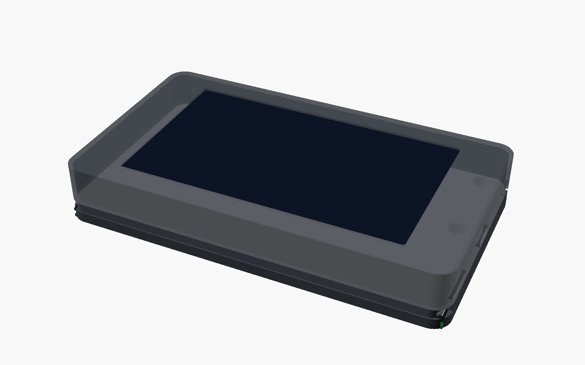
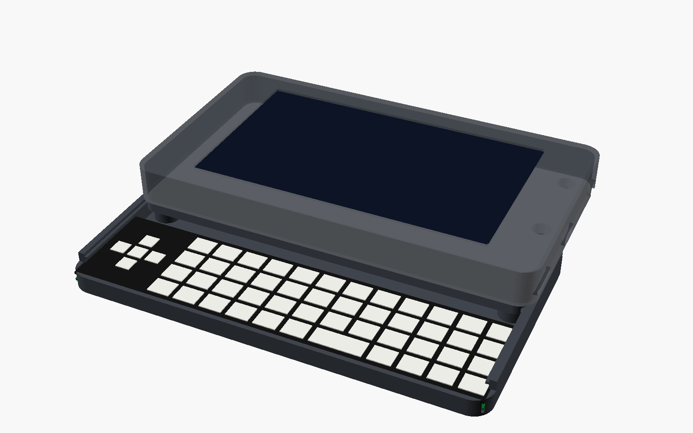
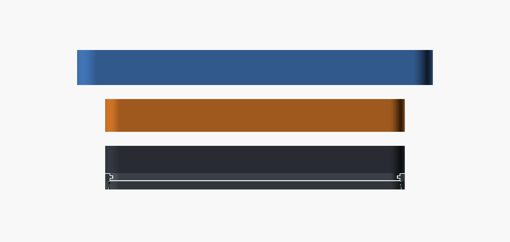

# HackerSlide 810

A pocketable Linux handheld in the spirit of the Nokia N810: landscape screen, slide-out QWERTY keyboard with a
D-pad, an off-the-shelf CM4-format compute module on a custom carrier board. Open hardware.

**Status: rev 0.1 is designed and checked as far as it can be without parts. Nothing has been built or tested:
the first boards are the test.**





Dark: HackerSlide 810, 128 x 74 x 20.05 mm. Orange: Nokia N810, 14 mm. Blue: Librem 5, 15 mm.

## What it is

| | |
|---|---|
| Compute | LuckFox Core3566 (RK3566, 4x Cortex-A55), swappable for other CM4-format modules within limits |
| Display | 4.0" 480 x 800 IPS, capacitive touch |
| Keyboard | 48 keys + D-pad, tact switches, I2C scanner, slides out on rails with magnet detents |
| Battery | 2800 mAh pack, USB-C charging |
| I/O | USB-C, 3.5 mm headset jack, microSD, Wi-Fi/Bluetooth on the module |
| OS | Debian/Mobian on a mainline-ish kernel (not started) |

## Where things stand

| Part | State |
|---|---|
| Carrier board | Schematic audited and revised; **fully routed**, no DRC errors. Power blocks, USB and DSI pairs laid by hand in the generator, the rest by the repository's grid router. Checked by scripts and by independent AI reviewers ([review](docs/review-2026-11-25.md)), not by a person; not built |
| Keyboard board | **Fully routed**, no DRC errors. Checked the same way; not built |
| Top plate, keyboard flex cable | Complete |
| Enclosure | Parametric fit-mule model, collision-checked |
| Fabrication files | Generated on demand by `hardware/scripts/fab_outputs.sh` and verified against the board files by `gerber_check.py`; not committed, not sent anywhere |
| Bring-up | Serial console, test pads on every rail, status lamps: [bring-up plan](docs/bring-up-plan.md), [test points](docs/test-points.md), [device-tree requirements](docs/device-tree.md) |

Start with [`docs/audit-status.md`](docs/audit-status.md), then [`docs/open-questions.md`](docs/open-questions.md).

## Documents

[requirements](docs/requirements.md) · [architecture](docs/architecture.md) ·
[decisions](docs/decisions/README.md) · [pin matrix](docs/compute-pin-matrix.md) ·
[power budget](docs/power-budget.md) · [thermal](docs/thermal.md) · [carrier board](docs/carrier-board.md) ·
[keyboard](docs/keyboard.md) · [enclosure](docs/enclosure.md) · [bring-up plan](docs/bring-up-plan.md) ·
[risks](docs/risks.md) · [roadmap](docs/roadmap.md) · [audit](docs/audit-2026-11-24.md) ·
[footprint review](docs/footprint-review.md) · [pre-fab review](docs/review-2026-11-25.md) · [test points](docs/test-points.md) ·
[device tree](docs/device-tree.md) · [routing status](docs/routing-status.md) · [BOM](bom/bom.csv) · [purchasing](bom/purchasing.md) ·
[fab orders](bom/fab-orders.md)

## Regenerating everything

The boards and the enclosure are generated from Python. Needs KiCad 9 with its libraries, Python 3, CadQuery and
OpenSCAD; details in [`docs/HANDOFF.md`](docs/HANDOFF.md), section 2.

```sh
hardware/scripts/build_all.sh                               # libraries, schematics, boards, ERC/DRC
ROUTE=1 VENV=$PWD/.venv hardware/scripts/build_all.sh       # the same, plus routing (slow; venv needs scikit-image)
hardware/scripts/render_boards.sh                           # board renders
hardware/scripts/fab_outputs.sh hardware/carrier carrier /tmp/fab   # Gerbers, drill, placement (then gerber_check.py)
cd mechanical/src && ../../.venv/bin/python hackerslide.py  # enclosure, collision check
python3 render.py ..                                        # renders
python3 ../../bom/tools/make_bom.py                         # BOM with current JLCPCB prices
```

## How to help

Review it. The questions we most want answered are in [`docs/open-questions.md`](docs/open-questions.md); the
things a hardware reviewer should check are in [`docs/carrier-board.md`](docs/carrier-board.md) and
[`docs/footprint-review.md`](docs/footprint-review.md). Open an issue.

## Licence

- **Hardware design** (`hardware/` and `mechanical/`: schematics, boards, libraries, enclosure models and their
  exported files) is licensed under the **CERN Open Hardware Licence Version 2 - Strongly Reciprocal**
  (CERN-OHL-S-2.0), see [`LICENSES/CERN-OHL-S-2.0.txt`](LICENSES/CERN-OHL-S-2.0.txt).
- **Software and documentation** (everything else, and the Python generator scripts inside `hardware/scripts/`
  and `mechanical/src/`, which are also covered as hardware source) are licensed under the **GNU Affero General
  Public License v3.0**, see [`LICENSE`](LICENSE).

Both are strong copyleft: anyone who distributes a modified design or a product made from it must publish their
source under the same terms.

Source location for CERN-OHL-S section 4: https://github.com/ruapotato/hackerslide
