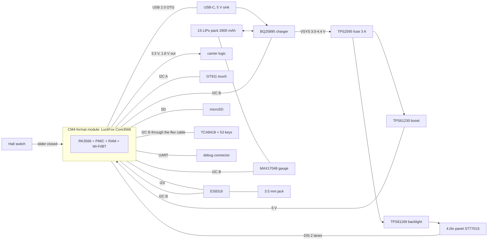

# Architecture

## Boards

| Board | Size | Layers | What is on it |
|---|---|---|---|
| Carrier | 71.6 x 66 mm, 1.0 mm | 4 | Module sockets, power chain, codec, connectors, buttons |
| Keyboard | 125 x 69 mm, 1.0 mm | 2 | 53 switches, diodes, TCA8418. It is also the floor of the keyboard tray |
| Top plate | 125 x 31 mm, 0.8 mm | 2 | Holds the keycaps; carries the Fn legends |
| Keyboard flex | 4.5 x 79 mm, 0.07 mm | 1 (flex) | Eight traces between carrier and keyboard |

## Stack-up, closed, bottom to top (mm)

| Layer | Thickness | Running total |
|---|---|---|
| Keyboard PCB (tray floor) | 1.0 | 1.0 |
| Switch, keycap, gap up to the top plate | 1.5 | 2.5 |
| Top plate | 0.8 | 3.3 |
| Tray rim | 0.3 | 3.6 |
| Slide gap | 0.4 | 4.0 |
| Back shell floor | 1.2 | 5.2 |
| Bay: the battery pack, 9.5 + 0.3 for swelling. Beside it: module 5.08 + thermal gap 0.42 = cavity 5.5; carrier 1.0; 3.3 behind the panel (1.9 needed for its folded tails) | 9.8 | 15.0 |
| Panel | 4.25 | 19.25 |
| Bezel lip | 0.8 | 19.35 |

All numbers are in `mechanical/src/config.py`; the model prints them into `mechanical/collision-report.json`.

## Plan view

The carrier fills the device's right 72 mm with its port edge at the right wall. The cell bay fills the left
54 mm. The panel covers both. The carrier is mounted with its component side down, so the module's SoC faces the
back shell and the bare side faces the display.

## Interfaces between boards

| Link | Signals | Connector |
|---|---|---|
| Carrier to panel | 2-lane DSI, reset, TE, 3.3 V, backlight anode/cathode | J4, FH34SRJ 20-way, display side |
| Carrier to touch | I2C A, interrupt, reset, 3.3 V | J5, FH34SRJ 8-way, display side |
| Carrier to keyboard | I2C B, interrupt, reset, 3.3 V, ground | J9 to keyboard J1 through the flex, FH34SRJ 8-way both ends |
| Carrier to cell | VBAT, ground | J10 (PH-type) or solder pads J3 |

I2C addresses on bus B: charger 0x6A, gauge 0x36, codec 0x10, keyboard 0x34. Bus A: touch 0x5D or 0x14.
