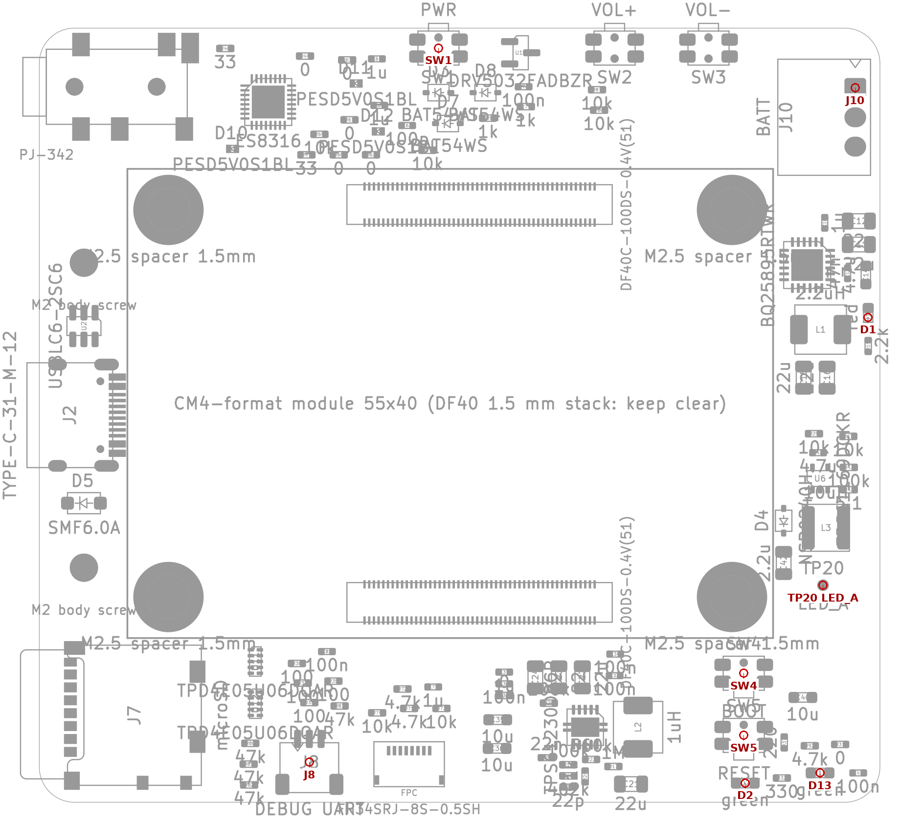
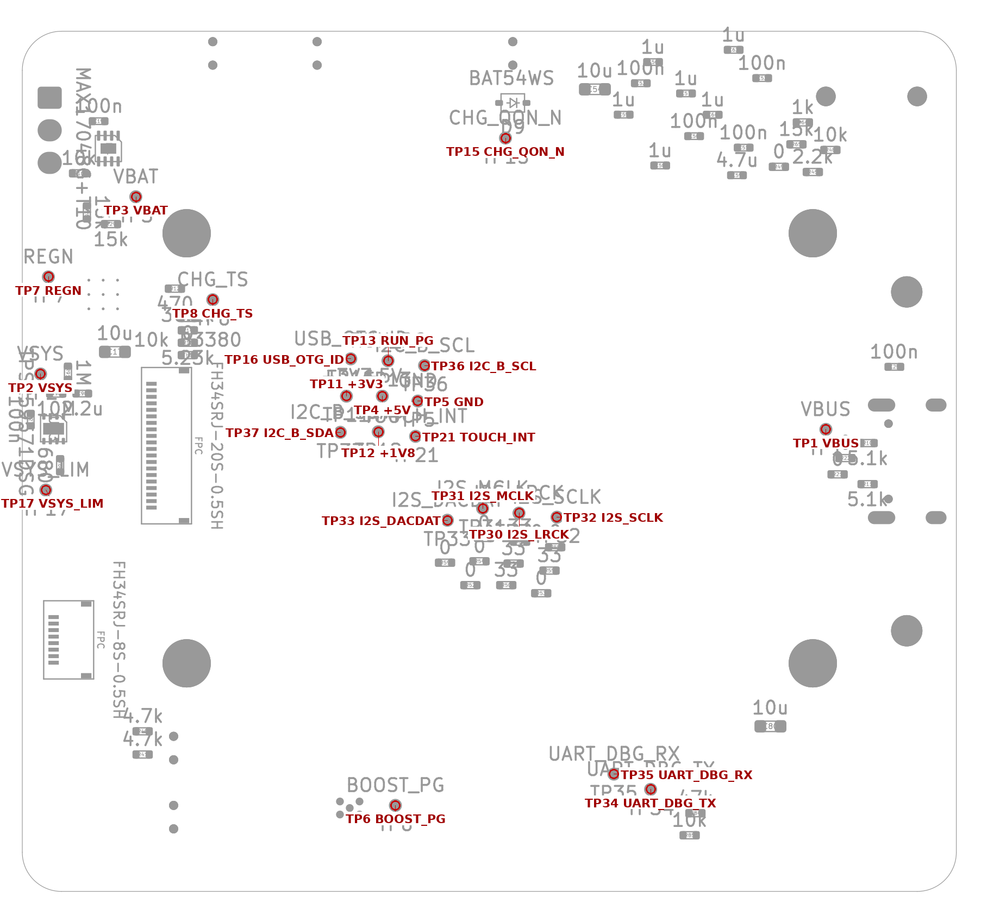

# Carrier test points

Generated by `hardware/scripts/testpoints.py` from the board file; do not edit.
Positions are board coordinates in mm (origin top left, seen from the module side). The display-side
picture is mirrored, so it shows that side as you see it with the board turned over.

| Ref | Net | Side | x | y | What to expect |
|---|---|---|---|---|---|
| TP1 | VBUS | display | 10.0 | 30.6 | 5 V with USB plugged in |
| TP2 | VSYS | display | 70.2 | 26.3 | 3.5-4.3 V: charger output (about 3.65 V on USB with no pack) |
| TP3 | VBAT | display | 62.9 | 12.7 | pack voltage, 3.0-4.2 V |
| TP4 | +5V | display | 44.0 | 28.0 | 5.0 V (4.75-5.25) when the boost runs |
| TP5 | GND | display | 41.3 | 28.4 | ground: scope clip |
| TP6 | BOOST_PG | display | 43.0 | 59.4 | high (3.3 V) when 5 V is in regulation |
| TP7 | REGN | display | 69.6 | 18.8 | about 6 V with USB in, charger internal supply |
| TP8 | CHG_TS | display | 57.0 | 20.6 | 30-74 % of REGN with the pack thermistor connected (charging allowed) |
| TP11 | +3V3 | display | 46.8 | 28.0 | 3.3 V from the module |
| TP12 | +1V8 | display | 44.3 | 30.7 | 1.8 V from the module |
| TP13 | RUN_PG | display | 43.6 | 25.3 | high when the module runs; pulled low by RESET |
| TP15 | CHG_QON_N | display | 34.6 | 8.2 | high (pack voltage); low while the power button is held |
| TP16 | USB_OTG_ID | display | 46.4 | 25.1 | module OTG ID pin |
| TP17 | VSYS_LIM | display | 69.8 | 35.2 | same as VSYS when the fuse U13 is on; 0 V if it has tripped or is held off |
| TP20 | LED_A | module | 66.8 | 47.5 | backlight anode: about 12.8 V when lit, up to 39 V if the panel is unplugged (careful) |
| TP21 | TOUCH_INT | display | 41.5 | 31.1 | pulses low on touch |
| TP30 | I2S_LRCK | display | 33.5 | 37.0 | 48 kHz while audio plays |
| TP31 | I2S_MCLK | display | 36.3 | 36.6 | 12.288 MHz while the codec is open |
| TP32 | I2S_SCLK | display | 30.6 | 37.3 | bit clock while audio plays |
| TP33 | I2S_DACDAT | display | 39.0 | 37.5 | data while audio plays |
| TP34 | UART_DBG_TX | display | 23.4 | 58.2 | console out of the module, 3.3 V idle high, 1,500,000 baud 8N1: to the adapter's RX |
| TP35 | UART_DBG_RX | display | 26.3 | 57.0 | console into the module: from the adapter's TX (3.3 V adapters only) |
| TP36 | I2C_B_SCL | display | 40.8 | 25.6 | system I2C clock, idles at 3.3 V (0x6A charger, 0x36 gauge, 0x10 codec, 0x34 keyboard) |
| TP37 | I2C_B_SDA | display | 47.2 | 30.8 | system I2C data, idles at 3.3 V |
| SW1 |  | module | 34.0 | 1.7 | power button |
| D1 |  | module | 70.6 | 24.6 | red: charging (blinks on a charger fault) |
| D2 |  | module | 60.1 | 64.4 | green: module activity |
| SW4 |  | module | 60.0 | 55.0 | BOOT: hold while applying power for the USB loader |
| SW5 |  | module | 60.0 | 60.3 | RESET |
| J8 |  | module | 23.0 | 62.6 | debug UART socket (JST-SH, Raspberry Pi Debug Probe lead): 1 RX in, 2 GND, 3 TX out |
| J10 |  | module | 69.5 | 5.1 | battery: + / thermistor / - marked on the board. Check the plug with a meter first |
| D13 |  | module | 66.5 | 63.5 | green: 5 V rail is up |
